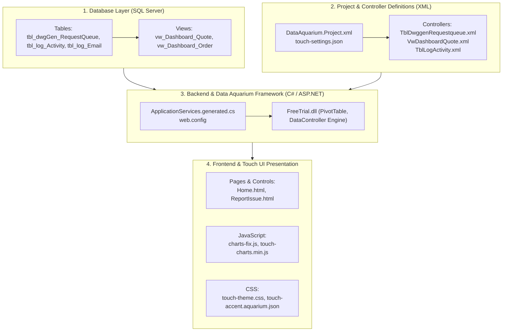

# DrawingGen Project — Complete Codebase & File Architecture Guide

This document provides a comprehensive walkthrough of the **DrawingGen** project built with **Code On Time (Touch UI / Data Aquarium Framework)** and **ASP.NET**. It explains the role, structure, and key configurations of all important files across the repository.

---

## 1. High-Level Architecture Overview



---

## 2. Solution & Project Root Configuration Files

These files configure how Code On Time compiles, synchronizes, and executes the web application.

| File Path | Purpose |
| :--- | :--- |
| `DrawingGen.sln` | The Visual Studio solution file referencing the web application in `app/` and the precompiled target in `PrecompiledWeb/`. |
| `DataAquarium.Project.xml` | Master Code On Time project definition: connection strings, UI type (`TouchUI`), theme (`Aquarium`), local IIS Express port (`44352`), and feature toggles. |
| `DataModel.xml` | Visual Data Model metadata mapping database tables and foreign key relationships to controllers. |
| `DataAquarium.Version.xml` | Records the project generator version and timestamp to manage incremental rebuilds. |
| `fix-home-charts.ps1` | PowerShell utility script to automatically reapply chart view settings (`type="Grid"`, `commandId="command1"`) after Code On Time regenerates the codebase. |

---

## 3. Web Application Core (`DrawingGen/app/`)

### Configuration & Master Shell

* `app/touch-settings.json`
  Configures the Touch UI client behavior:
  * `"appName"`: Set to `"DWG GEN AUTOMATION ADMIN DASHBOARD"`.
  * `"ui.sidebar"`: Controls the navigation menu visibility (`"when": "Always"`).
  * `"ui.readingPane"`: Reading pane behavior (`"enabled": false`).

* `app/web.config`
  The standard ASP.NET configuration file:
  * Registers Data Aquarium Framework HTTP handlers (`Blob.ashx`, `Theme.ashx`, `Export.ashx`, `Report.ashx`).
  * Configures connection strings and authentication modes.
  * Touching this file forces ASP.NET to recycle the application pool and clear all in-memory caches.

* `app/Web.Sitemap`
  Defines the primary navigation hierarchy and top menu items:
  1. **Home** (`~/pages/home`)
  2. **Request Queue** (`~/pages/tbl-dwggen-requestqueue`)
  3. **Activity Log** (`~/pages/tbl-log-activity`)
  4. **Email Log** (`~/pages/tbl-log-email`)
  5. **Report Issue** (`~/pages/report-issue`)

---

## 4. Data Controllers (`app/controllers/`)

Controllers are the heart of Code On Time. Each `.xml` file defines commands (SQL queries), fields, data views (grids, forms, charts), action groups (buttons), and business logic.

```
app/controllers/
├── TblDwggenRequestqueue.xml    # Main workflow queue + Status Bar
├── TblLogActivity.xml           # Activity log table & custom view layouts
├── TblLogEmail.xml              # Email delivery history
├── VwDashboardQuote.xml         # Quote Drawing analytics & Google Charts
└── VwDashboardOrder.xml         # Order Drawing analytics & Google Charts
```

### 1. `TblDwggenRequestqueue.xml`
* **Command 1 (SQL)**: Queries `tbl_dwgGen_RequestQueue`. Calculates computed fields like `StatusText` ('Processing', 'Completed', 'Failed') and `SubStatusText`.
* **SubStatusText Calculation**: Checks timestamp columns (`dateDWGGenFailed`, `dateEmailSent`, `dateSAPFileAllCompleted`, `dateDWGGenAllCompleted`, `dateTactonUploadStarted`) to determine the current progress step.
* **Status Bar (`<statusBar>`)**: Renders the chevron process tracker:
  `[Request Submitted] > Caller > AutoCAD > SAP > File Transfer > DWG Download Email`

### 2. `VwDashboardQuote.xml` & `VwDashboardOrder.xml`
* **View `chartCompany`**: The dashboard chart configuration.
* **Pivot Tags**:
  * `ReceivedDate` (`tag="pivot1-row1-date-columnstacked pivot2-row1-date-columnstacked"`): Binds the X-axis and activates automatic calendar quarter bucketing (**Q1, Q2, Q3**).
  * `RequesterCompany` (`tag="pivot1-col1"`): Stacks bar segments by company.
  * `Requester` (`tag="pivot2-col1"`): Stacks bar segments by requester.
  * `Status` (`tag="pivot3-row1-donut"`): Renders the circular status breakdown chart.

### 3. `TblLogActivity.xml`
* **Grid View**: Configured for 3-column layout (`Date`, `Application`, `Details`).
* **Header / Subtitle**: Labeled `Activity` / `Activity`.
* **Form View**: Cleaned to remove Edit/Delete actions, displaying Request Number, Application, User, Type, Date, Server, and left-aligned Details.

---

## 5. UI Pages & Controls (`app/pages/` & `app/controls/`)

### Pages (`app/pages/`)
Each `.html` file in `app/pages/` acts as an entry container rendered within the Touch UI single-page application:

| Page | Description |
| :--- | :--- |
| `Home.html` | Dashboard container. Embeds `TableOfContents` user control and tabs for **Quote Drawing** (`view2` $\rightarrow$ `VwDashboardQuote`) and **Order Drawing** (`view1` $\rightarrow$ `VwDashboardOrder`). |
| `ReportIssue.html` | Container hosting the Report Issue user control with forced SPX Blue top navbar styling. |
| `TblDwggenRequestqueue.html` | Hosts the Request Queue data grid and status bar. |
| `TblLogActivity.html` | Hosts the Activity Log data grid. |
| `TblLogEmail.html` | Hosts the Email Log data grid. |

### Controls (`app/controls/`)
Reusable HTML/JS components embedded into pages:

* `controls/ReportIssue.html`:
  A complete custom feedback interface featuring:
  1. **Landing Card**: "Click the below link to submit the feedback" with orange `[ Submit feedback ]` button.
  2. **Modal Dialog**: Styled popup modal matching Jira/Atlassian specifications (Summary input, Priority selector with arrows, Rich text description editor, attachments, Reporter name/email).
  3. **Touch UI Script Execution**: Uses `<script type="$app.execute">` so Code On Time executes the script across AJAX page navigations.

---

## 6. Client-Side JavaScript (`app/js/`)

Code On Time combines scripts from `app/js/` into bundled web resources.

```
app/js/
├── charts-fix.js               # Global custom enhancements & styling hooks
├── daf/
│   ├── touch-core.js           # Touch UI framework source code (8,683 lines)
│   ├── touch-core.min.js       # Production minified core framework
│   ├── touch-charts.min.js     # Google Charts & Pivot aggregation engine
│   └── touch.min.js            # Mobile & desktop Touch UI presentation widgets
└── _ignore.txt                 # Excludes specific folders from automatic bundle inclusion
```

### Key Scripts

1. `app/js/charts-fix.js`
   * **Navbar Enforcer**: Injects `#spx-navbar-force-style` dynamically into `<head>` to maintain the solid SPX blue navbar (`#0089ce`) and crisp `#ffffff` text across all navigation changes.
   * **Google Charts Loader**: Loads Google Charts library (`corechart`, `bar`, `line`) and initializes charts when views become active.
   * **Watermark Purger**: Automatically detects and hides free trial footer watermarks on `pageready.app`, `pageinit.app`, and DOM ready events.

2. `app/js/daf/touch-charts.min.js`
   * Receives pivot data from the server.
   * Translates `$Quarter1`, `$Quarter2`, `$Quarter3` into display labels **Q1**, **Q2**, **Q3**.
   * Draws Google Visualization `ColumnChart`, `BarChart`, and `PieChart` instances.

3. `app/js/daf/touch-core.js`
   * The unminified reference file for the entire Data Aquarium Framework client layer. Useful for debugging without dealing with single-line minified code.

---

## 7. Stylesheets & Theming (`app/css/`)

* `app/css/themes/touch-accent.aquarium.json`
  Defines the SPX color scheme:
  * Primary Accent: `#0089ce`
  * Header Background: `#0089ce`
  * Header Text: `#ffffff` / `#f5f5f5`

* `app/css/daf/touch-theme.css`
  Core Touch UI theme CSS. Contains styles for toolbars (`#app-bar-toolbar`), buttons, listviews, modal dialogs, and navigation strips.

* `app/css/custom.css`
  Project-specific override stylesheet automatically bundled by Code On Time into `~/appservices/stylesheet-....min.css`.

---

## 8. Database Schema & SQL Scripts

* `app/Schema.sql/schema.sql`
  Contains the SQL Server DDL for:
  * Table `dbo.tbl_dwgGen_RequestQueue`: Stores all automation drawing requests, Tacton IDs, timestamps, failure flags, and requester information.
  * Table `dbo.tbl_log_Activity`: System log entries, audit records, and server activity.
  * Table `dbo.tbl_log_Email`: Outgoing notification email logs.
  * View `dbo.vw_Dashboard_Quote`: Filters `tbl_dwgGen_RequestQueue` for `jobRequestType = 'Quote'`.
  * View `dbo.vw_Dashboard_Order`: Filters `tbl_dwgGen_RequestQueue` for `jobRequestType = 'Order'`.

---

## 9. Quick File Lookup by Feature

| What do you want to modify? | Where to go? |
| :--- | :--- |
| **Change top navbar color or links** | `app/js/charts-fix.js` & `touch-theme.css` |
| **Change status bar chevron stages** | `app/controllers/TblDwggenRequestqueue.xml` (`<statusBar>`) |
| **Change dashboard chart metrics or groupings** | `app/controllers/VwDashboardQuote.xml` (`view chartCompany`) |
| **Change Report Issue feedback form** | `app/controls/ReportIssue.html` |
| **Add or reorder top menu tabs** | `app/Web.Sitemap` |
| **Edit Activity Log columns or detail view** | `app/controllers/TblLogActivity.xml` |
| **Modify SQL query logic** | `app/controllers/*.xml` under `<command id="command1">` |
